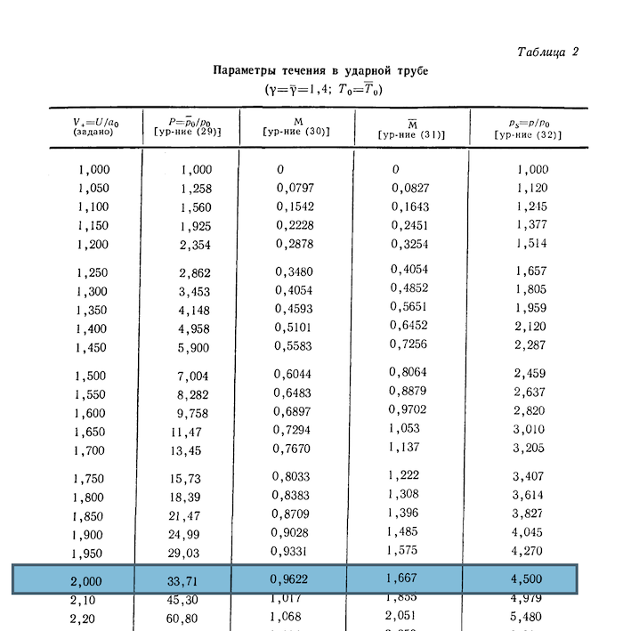
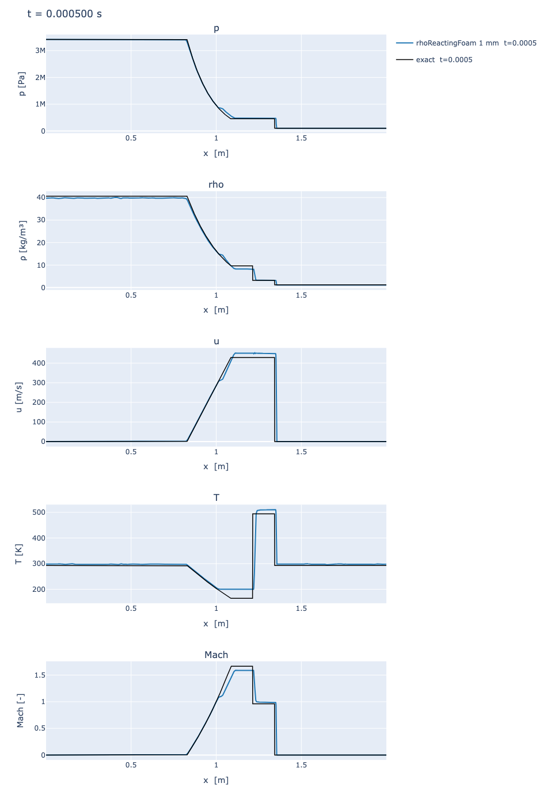
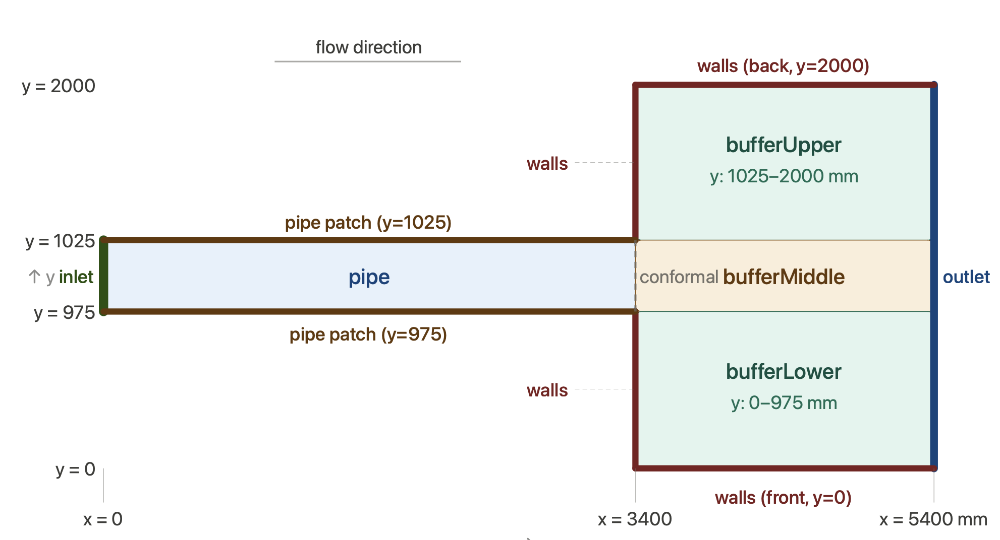
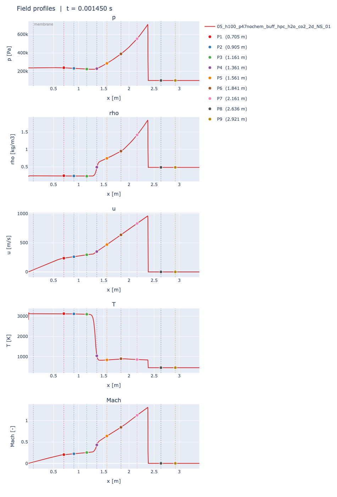
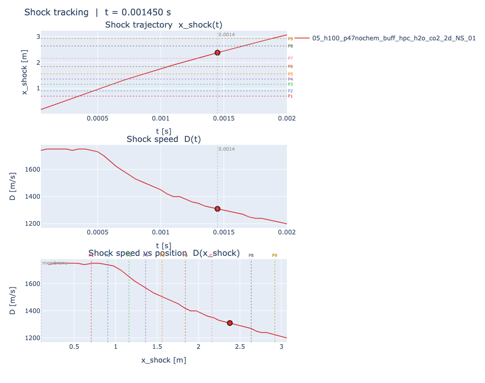
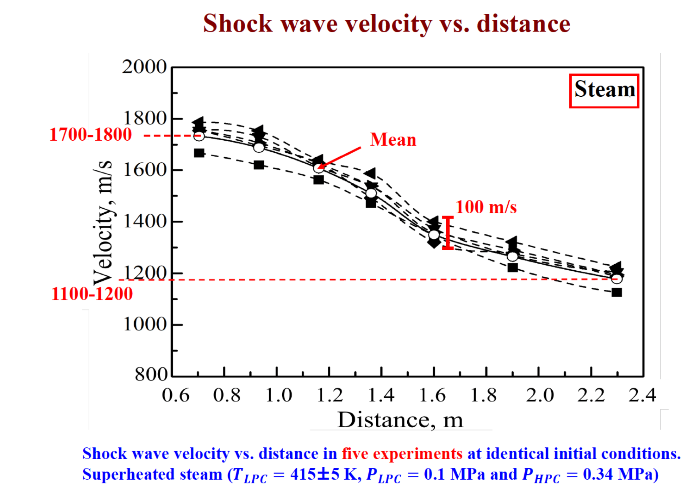

# Исследование гидролиза триэтилалюминия Al(C2H5)3
 

На данной странице находятся рабочие материалы по исследованию гидролиза триэтилалюминия в [лаборатории детонации](https://www.chph.ras.ru/index.php/2-uncategorised/1452-lab-1313) [ФИЦ ХФ РАН](https://www.chph.ras.ru/). Это численное и экспериментальное исследование тепловых процессов с участием триэтилалюминия, предполагаемых на основании материалов статей [1](../../data/2023-20-rus.pdf), [2](../../data/2025-14-rus.pdf) и [презентации](../../data/Frolov-China.pdf).

В работе участвуют:
- Фролов Сергей Михайлович (руководство проектом)
- Авдеев Константин (эксперимент)
- Поскребышев Григорий (химическая кинетика)
- Кузовлев Дмитрий (моделирование в cantera/openfoam и оформление результатов)
 

## План исследования
 

<mark>Цветом</mark> выделен этап, на котором мы находимся на момент последнего редактирования страницы (26 10 2026).

1) *верифицировать солвер, сравнить с данными fire на тесте sod для воздуха без химии*
2) *сравнить расчеты с экспериментом, как ударная волна врезается в пар без учета химии. Воспроизвести зависимость скорости и давления от времени*
3) <mark>подобрать химическую кинетику для гидролиза TEA </mark>
4) смоделировать инжектор
5) смоделировать разрыв мембраны
6) подготовить публикацию

Ожидаемый результат по итогам исследования:
1) валидированная экспериментальными данными химическая кинетика гидролиза TEA
2) карта режимов горения и детонации
3) валидированная модель инжектора и разрыва мембраны
4) статья/статьи
 

## 1. Верификация солверов по табличным данным и точным расчетам
 

Работаем с [rhoReactionCentralFoam](https://github.com/duncanam/rhoReactingCentralFoam) + of7 и [detonationFoam v1/v2](https://github.com/JieSun-pku/detonationFoam) + of6/of8. Вязкость и другие эффекты переноса на данном этапе не учитываются, течение описывается уравнениями Эйлера. Для удобства работы в docker на ARM64 rhoReactionCentralFoam был портирован под of8 (см. [github.com/completebasis/TEA/dockerfiles](https://github.com/completebasis/TEA/) )

 
Для верификации солверов настроили и запустили задачу Сода для воздуха, сравнили установившуюся скорость газа после разрыва мембраны с табличными данными из «Ударные трубы» (под ред. Х. А. Рахматуллина и С. С. Семенова, 1962), см. ниже: 
 
 

 (Показать) Таблица параметрами течений в ударной трубе для воздуха

 

### Постановка задачи Сода
 

Ударная труба длиной 10 м, мембрана на расстоянии 1 м от левого края. Слева - КВД (P=33.71 Атм, ρ=40.6116 kg/m³)), справа - КНД (P=1 Атм, ρ=1.2047 kg/m³). В обеих камерах T=293К. Рассматривалась одномерная задача с граничными условиями непротекания (zeroGradient) и проскальзывания (slip), течение Эйлера.

Результаты расчета в сравнении с точным решением см. на рисунке ниже:

 (Показать) Расчет течения в сравнении с точным решением

 

По итогам был выбран размер расчетной ячейки 1мм по x.
 

## 2. Валидация на эксперименте с паром без химии
 
Использовалась такая же геометрия, как в натурном эксперименте с ударной трубой. Явно моделировался буфер, в который вытекает газ, так как так устроена экспериментальная установка и было решено не моделировать проницаемое граничное условие.

Толкали пар аргоном *Ar* и гелием *He*. В итоге остановились на *He*, так как нужно меньшее начальное давление в КВД. В КНД 400К. Размер КВД пришлось уменьшить, так как с большим КВД скорость УВ не падала, тк волна разрежения не успевала догнать фронт УВ.

 (Показать) Геометрия задачи с паром

 

Получилось "поймать" затухание скорости при длине КВД 0.1 м и давлении 4.7 МПа. Тоже наблюдается спад от 1800 до 1200 м/сек

 (Показать) Сравнение расчета с результатами эксперимента из презентации

 

Как вариант, в дальнейшем можно будет сделать двухкамерный КВД или задать распределение в КВД. Более точно решим потом, после валидации кинетики.

 

## 3. Подбор кинетики TEA
 

Подбор кинетики делаем последовательным добавлением реакций и компонент в механизм. Делаем анализ расчетов гомогенного реактора и распределения полей в ударной трубе. Проверяем количество образовавшихся компонент смеси и оцениваем их вклад в кинетику.

#### Параметры гомогенного реактора
 

Адиабатический гомогенный реактор, идеальный газ, горение при постоянном объеме.
Начальная температура T0 = 700 K, начальное давление P0 = 1 Атм, Y0 = "TEA:0.6787, H2O:0.3213", время эксперимента 0.1 сек 

Код запуска расчета на cantera: [run_reactor.py](../TEA/data/run_reactor.py) 

#### Параметры ударной трубы 
 
Адиабатические гладкие стенки, идеальный газ. Начальное соотношение молей 1TEA к 3H2O. 
 


convertToMeters 1;

vertices 
( 
        (0 0 -0.05)
        (6.80000 0 -0.05)
        (6.80000 0.05 -0.05)
        (0 0.05 -0.05)
        (0 0 0)
        (6.80000 0 0)
        (6.80000 0.05 0)
        (0 0.05 0)
);

blocks
(
	hex (0 1 2 3 4 5 6 7) (13600 1 1) simpleGrading (1 1 1)

);



// Shock tube initial conditions
// Diaphragm at x = 0.05 m (tube midpoint)
//
// LEFT  (driver):    high p, high T — hot combustion products or driver gas
// RIGHT (driven):    low p,  low T  — cold TEA + H2O mixture
//    // Stoichiometric TEA+H2O, 1:3 molar ratio
    // Y_TEA = 0.6787,  Y_H2O = 0.3213
// * * * * * * * * * * * * * * * * * * * * * * * * * * * * * * * * * * * * * //

defaultFieldValues          // RIGHT — cold reactive mixture
(
    volScalarFieldValue T        400
    volScalarFieldValue p        101325
    volVectorFieldValue U        (0 0 0)
    volScalarFieldValue TEA      0.6787
    volScalarFieldValue H2O      0.3213
    volScalarFieldValue DEALOH   0
    volScalarFieldValue DEALOOH  0
    volScalarFieldValue AlOH3    0
    //volScalarFieldValue C2H6     0
    volScalarFieldValue He	 0
);

regions
(
    boxToCell                   // LEFT — pure hot He driver
    {
        box  (-0.00001  -0.06  -0.06)
             ( 0.6   0.060   0.06);
        fieldValues
        (
            volScalarFieldValue T        400
            volScalarFieldValue p        3.16228e+07 // 
            volVectorFieldValue U        (0 0 0)
            volScalarFieldValue TEA      0
            volScalarFieldValue H2O      0
            volScalarFieldValue DEALOH   0
            volScalarFieldValue DEALOOH  0
            volScalarFieldValue AlOH3    0
            //volScalarFieldValue C2H6     0
            volScalarFieldValue He	 1.0
        );
    }
);


 
 

Код запуска расчета на of8: [basecase.zip](../TEA/data/basecase.zip) 

Дополнительно провели верификацию гомогенного реактора реализованного в openfoam с реактором на cantera. Результаты расчетов  совпадают.

### Сравнение кинетических механизмов

<iframe id="multi-comparison" src="/reactingflows/images/multi_comparison.html" width="100%" height="820" scrolling="no" style="border:0;display:block" loading="lazy"></iframe>

## 4. Модель инжектора
 
Варианты:

1) отверстие в верхней стенке и инжектор газа под заданным углом по заданному закону U(t), p(t), T(t), Y_i(t)
2) трубка внутрь канала (прямая или Г-образная) и инжектор газа по заданному закону
3) трубка внутрь канала и инжектор газа+жидкости по заданному закону

## 5. Модель разрыва мембраны
 

Пока не думали
## 6. Задержка времени воспламенения
 

Считаем двумя способами: в ударной трубе и в реакторе. В ударной трубе считаем методом лагранжнвых частиц и сравниваем с расчетом в предположении о постоянной скорости фронта

## 7. Карта режимов

При каких начальных условиях какие режимы наблюдаются -  горение, детонация

## Сокращения
 

- of - openfoam. Используется openfoam.org v6, v7, v8
- fire - https://www.avl.com/en/simulation-solutions/simulation-software/computational-fluid-dynamics-cfd-avl-fire-m
- УВ - ударная волна
- КВД - камера высокого давления
- КНД - камера низкого давления

## Справочные данные

<mark>Cp(T)</mark>